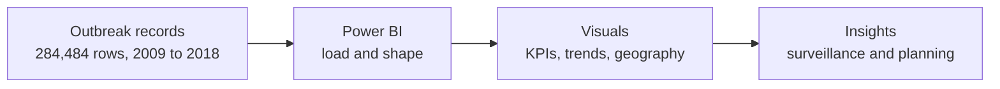

<h1 align="center">🦠 Disease Outbreaks in Nigeria, 2009 to 2018</h1>

  <b>An interactive Power BI dashboard that turns 284,484 outbreak records into a clear view of what was reported, where, when and with what outcome.</b>

  
  
  
  

)

---

## 📌 Overview

Public health teams need to see outbreak data at a glance: how big the burden is, which diseases drive it, where and when cases are reported, and how patients fared. This project answers those questions in a single dark-themed Power BI report, built for surveillance monitoring and public health planning.

The dashboard covers **ten years (2009 to 2018)**, **ten diseases**, and every Nigerian state, with a disease slicer that lets a viewer filter the whole page.

## 📊 At a glance

| 284,484 | 10 | 10 | 50.02% |
| :---: | :---: | :---: | :---: |
| cases reported | diseases tracked | years covered | of cases recorded as dead |

## ❓ Questions this dashboard answers

| Question | Answer |
| --- | --- |
| How many outbreak cases were reported? | **284,484** across 2009 to 2018 |
| Which diseases account for the most cases? | None dominates: all ten sit between 28,179 and 28,589 cases (9.91% to 10.05% each) |
| How did reporting change over time? | Cases peaked in **2013 (28,745)** and bottomed in **2011 (28,187)**; no year moved more than 1.5% from the one before |
| Where were cases reported? | Evenly across states: about 7,700 per state, from roughly 7,520 in Cross River to 7,820 in Kano |
| Who was affected? | Close to parity by gender (about 0.15M and 0.14M) and by settlement (rural and urban at 49.89% and 50.11%) |
| What were the outcomes? | **50.02% dead and 49.98% alive** |

## 💡 Key insights

1. **The burden is shared evenly across all ten diseases.** The largest disease holds 10.05% of cases and the smallest 9.91%, a spread of only 410 cases. A chi-square test cannot distinguish this from a perfectly even split (p = 0.87), so case volume alone does not tell planners which disease to prioritise.
2. **Yearly volume is stable.** The average is about 28,448 cases a year with a variation of only 0.6%. 2013 is the peak (10.10% of all cases), 2011 the low (9.91%), and 2018 ends just 0.39% above 2009, so there is no sustained rise or fall (p = 0.36).
3. **There is no geographic hotspot.** State counts cluster tightly around the national average of roughly 7,700, so the burden is a national one rather than a regional one.
4. **Rural and urban settlements carry the same load.** Cases split 49.89% and 50.11% (about 141.9K and 142.6K), so a response that favours one setting would leave half of the burden under-served.
5. **Men and women are affected at similar levels,** at roughly 0.15M and 0.14M cases.
6. **Half of reported cases are recorded as dead (50.02%).** That is very high for a mix that includes diseases such as malaria and diarrhoea, which makes the outcome field the first thing to validate with the data owner.

> [!NOTE]
> Every split in this dataset is unusually uniform: ten diseases within 1.5% of each other, ten years within 2%, and 50/50 splits on outcome and settlement. Ebola and Marburg virus, for example, carry case counts comparable to cholera and malaria. This pattern suggests the data is simulated or heavily balanced, so the findings describe this dataset and demonstrate the analysis method rather than the true epidemiology of Nigeria. The dashboard is designed to be re-pointed at real surveillance data.

## 🖥️ Dashboard walkthrough

| Visual | What it shows | Why it matters |
| --- | --- | --- |
| **Total cases reported** (card) | 284.484K records | Anchors every other number on the page |
| **Death cases** (donut) | Dead 50.02% and alive 49.98% | Shows the outcome split at a glance |
| **Gender** (column chart) | Case counts for the two gender groups | Checks whether either group is over-represented |
| **Case report by diseases** (area line with reference bands) | The ten diseases ranked from 28,589 down to 28,179 cases | Makes the near-equal disease burden obvious |
| **Diseases** (slicer) | Cholera, diarrhoea, Ebola, malaria, Marburg virus, measles, meningitis, rubella, viral haemorrhagic fever and more | One click filters the whole report to a single disease |
| **Settlement** (pie) | Rural and urban at 49.89% and 50.11% | Shows whether outbreaks favour one setting |
| **Yearly case report** (line) | Cases by report year, 2009 to 2018 | Reveals trend, peaks and troughs |
| **Cases by states** (table with total) | Count of cases for every state | Supports state-level benchmarking |

## 🛠️ How it was built

- **Tool:** Power BI Desktop
- **Fields analysed:** disease, health status, gender, settlement, state and report year
- **Visuals used:** KPI card, donut, column chart, line and area charts with reference lines, slicer, pie chart and a table with totals
- **Design choices:** a dark theme with one blue family for data, light header bands that group each section, a clear title, and a single slicer that drives the page

## ✅ Recommendations

| Priority | Recommendation | Based on |
| --- | --- | --- |
| 1 | Audit how the outcome field is recorded before using it for decisions | 50.02% of cases recorded as dead |
| 2 | Give all ten diseases equal surveillance coverage and set disease-specific alert thresholds, since volume does not separate them | Every disease holds 9.91% to 10.05% of cases |
| 3 | Keep rural and urban surveillance balanced | A 49.89% and 50.11% split |
| 4 | Treat a year-on-year change larger than about 1.5% as a signal worth reviewing | No year moved more than 1.5% from the previous year |
| 5 | Plan resources nationally, with state benchmarking against the roughly 7,700 average | No state stands out as a hotspot |

## ▶️ How to use

1. Download or clone this repository.
2. Open the `.pbix` file in [Power BI Desktop](https://powerbi.microsoft.com/desktop/).
3. Click a disease in the slicer to filter every visual, and click again to clear it.

## 🎯 Skills demonstrated

Power BI dashboard design · KPI and data storytelling · public health analytics · interactive filtering · statistical sense-checking (chi-square tests) · data quality review

## 👤 Author:
**Bolade Victor Oloruntayo** is a data analyst focused on business intelligence and health analytics, working with Power BI, Excel, Python, SPSS and SQL.
